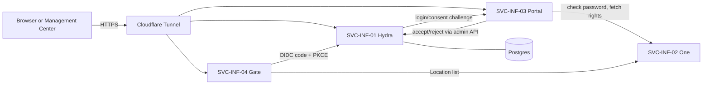

# Infinity-One

Product ID: PRD-INF-001 · v1.0.0 · Pillar: Security · Location: `Locations\Pillars\Security\Infinity`

Infinity-One is the single sign-in for every Trancendos Location: one account, like a Google or
Microsoft account, with rights set per Location. It is built from small, separate services
(nanoservices), each in its own folder and container.

| Service ID | Name | Folder | Port | Reached from | What it does |
|---|---|---|---|---|---|
| SVC-INF-01 | Infinity-One core (Ory Hydra) | `deploy/hydra` | 4444 public, 4445 admin | `auth.trancendos.com` (admin never public) | Standard OpenID Connect: authorize, token, JWKS, logout |
| SVC-INF-02 | One directory | `services/one` | 8043 | internal only | Users, password hashes (scrypt), rights per Location, audit log |
| SVC-INF-03 | Portal | `services/portal` | 8042 | `portal.trancendos.com` | The sign-in homepage: login, consent, logout pages |
| SVC-INF-04 | Gate | `services/gate` | 8046 | `gate.trancendos.com` | Navigator: shows each person the Locations they can open, by level |

How a sign-in works: an app (Gate, Management Center, TownHall) sends the person to Hydra. Hydra
asks Portal to sign them in. Portal checks the password with One and tells Hydra who it is. For
first-party apps the consent screen is skipped; Portal adds the person's Location rights to the
tokens. The app gets standard OIDC tokens (RS256, verifiable offline with the JWKS), so it never
sees a password.

Rights levels: `viewer` < `user` < `admin`. They are carried in tokens as
`rights: {"<location-id>": "<level>"}` and `platform_admin: true|false` (scope `infinity`).
Management Center requires `rights["management-center"] == "admin"`.

## Documents

- [docs/SETUP-VM-AND-TUNNEL.md](docs/SETUP-VM-AND-TUNNEL.md): step-by-step Oracle VM + Cloudflare Tunnel setup
- [docs/DNS-CUTOVER.md](docs/DNS-CUTOVER.md): the planned move of `auth.trancendos.com` (not done yet)
- [docs/INTEGRATION.md](docs/INTEGRATION.md): how Management Center, TownHall and other Locations sign people in
- [docs/TESTING.md](docs/TESTING.md): running it locally and the end-to-end tests
- [docs/DEPENDENCY-TRACKER.md](docs/DEPENDENCY-TRACKER.md): licences, costs, free alternatives
- [logs/ACTIVITY-LOG.md](logs/ACTIVITY-LOG.md): what was done, when, by whom
- [archive/](archive/): anything replaced, kept for human review

## Principles kept here

- Zero cost: open-source images, Oracle Always Free, Cloudflare Free. No Cloudflare Workers, no GitHub Actions.
- No npm dependencies in the services (Node standard library only).
- Nothing is deleted: replaced material goes to `archive/`.
- Accessible pages: labelled fields, live error region, skip link, keyboard focus, light/dark/auto theme.
